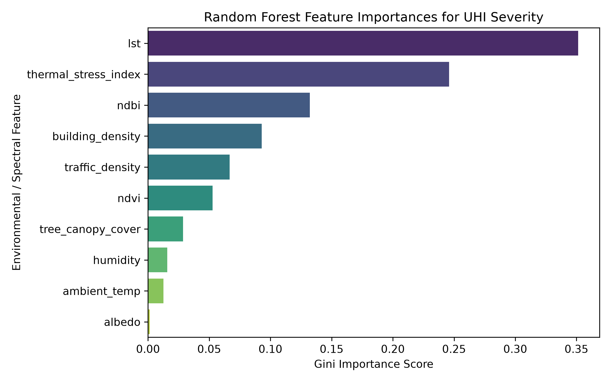
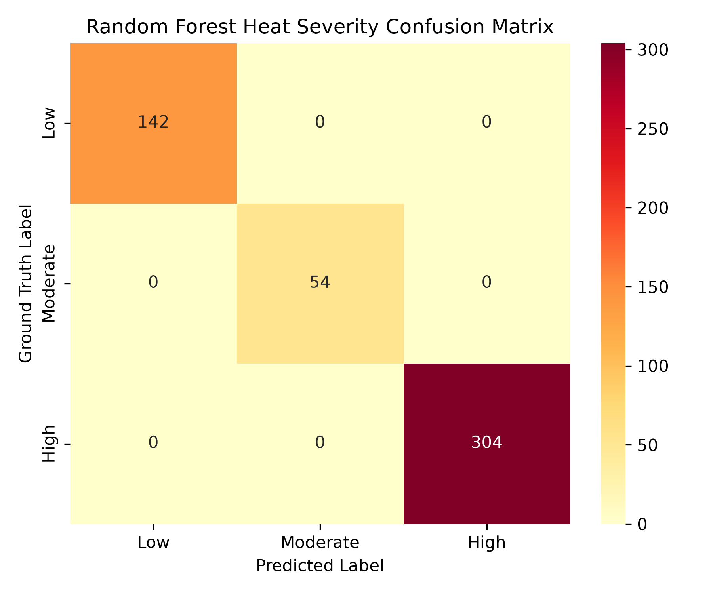

# Smart Cooling Strategy Recommendation System for Urban Heat Island Reduction 🏙️🌿

[](https://en.cppreference.com/w/c)
[](https://developer.mozilla.org/)
[](https://www.espressif.com/)

> A decision-support prototype for exploring urban heat conditions across Bengaluru micro-zones, comparing cooling interventions, and demonstrating an ESP32-based temperature and humidity telemetry path.

---

## 👨‍💻 Author

**Adarsh Srivastav**<br>
Computer Science and Engineering (CSE) Student<br>
Embedded Systems | IoT | C | GIS | Urban Sustainability

---

## 📌 Project Overview

Urban Heat Islands (UHIs) occur when built-up areas become warmer than nearby less-developed areas. Dark roofs and roads absorb and store solar heat, limited vegetation reduces shade and evapotranspiration, and human activities add waste heat. These conditions can vary significantly between nearby streets and neighborhoods.

The **Smart Cooling Strategy Recommendation System** is a prototype that brings together:

- A C99 engine for environmental feature preprocessing, thermal-stress assessment, severity classification, recommendations, and scenario estimates.
- ESP32 firmware intended to read air temperature and relative humidity from a DHT22 sensor and provide local OLED, LED, buzzer, and serial outputs.
- A browser dashboard with a Bengaluru micro-zone map, what-if simulator, telemetry views, cooling planner, intervention catalog, and JSON export.

The system is intended to help users compare possible actions, not to replace site surveys or municipal engineering. **Zone profiles, simulated readings, intervention costs, and cooling impacts must be treated as reference values or estimates unless independently measured and validated.**

---

## 🎯 Objectives

- Represent urban micro-zones using thermal, vegetation, built-form, and activity indicators.
- Validate and preprocess feature values before analysis.
- Calculate an Urban Thermal Stress Index (UTSI) and classify heat severity.
- Rank suitable cooling interventions and provide a rationale.
- Compare hypothetical intervention combinations and their estimated impacts.
- Demonstrate how an ESP32 can collect local air-temperature and humidity readings.
- Present the prototype through an interactive GIS dashboard and command-line simulator.

## 🏆 Competition-Ready Enhancement Strategy

This project is structured to stand out in a final-year engineering evaluation by combining three strong pillars:

- Virtual simulation: multi-zone GIS analysis, scenario simulator, heat-risk scoring, and intervention comparison matrix.
- Hardware validation: ESP32-based telemetry, actuators, live sensor readings, and serial connectivity for a realistic edge-computing workflow.
- Decision support: AI/offline planner, municipal action export, resilience scoring, and a deployment roadmap for real-world stakeholders.

The dashboard has been upgraded with an urban resilience index, priority ranking across micro-zones, and a stakeholder-ready action summary so the prototype reads like a polished capstone presentation instead of a static demo.

## 🏅 Competition Presentation Narrative

A strong engineering project presentation should explain:

- It addresses a real city problem with visible social impact.
- It combines data, software, and hardware instead of relying on a single technology.
- It demonstrates both analysis and action through a usable planning system.
- It explains why the solution is practically useful to planners and communities.

The prototype connects configured heat indicators to intervention planning, simulated telemetry, and a documented ESP32 sensing path. Present these as prototype capabilities; the environmental profiles and estimated impacts still require independent validation.

## 🧭 Judge-Friendly Demo Script

1. Open the GIS map and explain the micro-zone concept.
2. Highlight one hot zone and explain the thermal indicators driving the recommendation.
3. Show the ranked intervention and rationale for that specific location.
4. Adjust the scenario sliders to demonstrate estimated cost and cooling impact.
5. Show the ESP32 telemetry or virtual stream to connect the software to the hardware prototype.
6. Export the action-plan JSON to show practical usability for planning and reporting.

This flow is easy to explain, visually strong, and demonstrates end-to-end project value in under five minutes.

## ✍️ Competition Abstract

The Smart Cooling Strategy Recommendation System for Urban Heat Island Reduction is a multidisciplinary capstone project developed to address localized urban thermal stress using micro-zone analysis, embedded sensing, and decision-support modeling. The system processes environmental and built-form indicators to identify heat-stressed regions, classify risk severity, and recommend suitable interventions such as cool roofs, urban forestry, green roofs, permeable pavements, and misting plazas. A GIS-based dashboard, C-based assessment engine, and ESP32 telemetry path work together to create a practical and demonstrable urban cooling solution.

The project is designed to bridge the gap between data-driven analysis and actionable urban policy support. It demonstrates how a city can prioritize cooling efforts based on local conditions rather than general averages, while also showing the role of embedded systems and simulation in validating real-time thermal behavior. This makes the prototype highly relevant for final-year engineering evaluation, where technical depth, interdisciplinary integration, and societal impact are all critical.

## ✅ Suggested Closing Statement for the Final Presentation

This project demonstrates a prototype workflow for urban heat decision support: inspect micro-zone indicators, compare cooling options, simulate assumed impacts, and evaluate an ESP32 sensing path. The next step is to validate the data, model behavior, and intervention assumptions through reproducible experiments and field measurements.

---

## ✨ Key Features

- **C99 assessment engine:** feature validation, preprocessing, UTSI calculation, and zone assessment.
- **C-implemented Random-Forest-style classifier:** 25 hand-coded decision-tree rules vote for LOW, MODERATE, or HIGH.
- **Five cooling interventions:** cool roofs, urban forestry, green roofs/living walls, permeable cool pavements, and misting plazas.
- **Scenario simulation:** combines intervention inputs with diminishing-return impact estimates, cost, energy, and carbon calculations.
- **Interactive Bengaluru map:** Leaflet map, eight selectable micro-zone profiles, diagnostic cards, and severity colors.
- **One shared project location:** selection is shared across dashboard operations and saved in browser storage.
- **Telemetry demonstrations:** Open-Meteo weather, generated virtual readings, or ESP32 Web Serial.
- **Local cooling planner:** deterministic rules-based advice works without an API key; optional OpenAI mode can be configured separately.
- **Action-plan export:** download a JSON report for the configured zones.
- **ESP32 firmware and Wokwi configuration:** embedded C firmware, circuit diagram, and simulation configuration are included.

> The dashboard's JavaScript recommendations and simulator are separate from the C engine. The dashboard does not execute the C classifier in the browser.

---

## 🏗️ System Architecture

```text
                         SMART COOLING SYSTEM
                                  │
         ┌────────────────────────┴────────────────────────┐
         │                                                 │
         ▼                                                 ▼
  DHT22 / ESP32                                Reference / GIS / Weather
  air temperature & RH                         zone and context data
         │                                                 │
         └────────────────────────┬────────────────────────┘
                                  ▼
                    Feature validation and preprocessing
                                  │
                   ┌──────────────┴──────────────┐
                   ▼                             ▼
          UTSI / zone assessment       C severity classifier
                   └──────────────┬──────────────┘
                                  ▼
                  Cooling strategy recommendations
                                  │
                   Scenario and impact estimation
                                  │
             ┌────────────────────┴────────────────────┐
             ▼                                         ▼
   C command-line simulator                 Browser dashboard
                                               │
                      ┌────────────────────────┼─────────────────────┐
                      ▼                        ▼                     ▼
                 GIS map                 Telemetry & planner      JSON export
```

---

## 🔄 Working Principle

```text
Collect or load environmental inputs
                 ↓
Validate ranges and handle missing values
                 ↓
Calculate thermal stress and severity
                 ↓
Rank suitable cooling interventions
                 ↓
Estimate impacts for selected scenarios
                 ↓
Display zone, telemetry, and scenario information
                 ↓
Export a planning summary
```

The inputs include air temperature, relative humidity, land-surface temperature (LST), NDVI, NDBI, albedo, building density, tree-canopy cover, traffic density, and population density.

### Important data distinctions

- The DHT22 measures **air temperature and relative humidity**. It does not measure LST, NDVI, NDBI, albedo, canopy, traffic, or population.
- Satellite-derived indices and land-surface temperature require separate remote-sensing data sources; they are not read by the current ESP32 firmware.
- The dashboard's eight zone profiles are configured reference values, not eight live sensor stations.
- Open-Meteo provides current weather for the selected coordinates. It is not a local ESP32 measurement and does not provide the dashboard's LST.
- The virtual stream generates simulated telemetry; it must not be presented as physical sensor output.
- In the current firmware, LST is set to ambient temperature plus 8°C and several other features use fixed example values. These are placeholders, not remote-sensing observations.

---

## 🧠 Heat Assessment and Classifier

The C engine includes:

1. **Preprocessing:** constrains input values to configured feature ranges and handles missing values.
2. **UTSI:** combines environmental and urban-form features into a thermal-stress score.
3. **Severity classification:** a C implementation of 25 hand-coded decision trees votes for LOW, MODERATE, or HIGH and returns confidence information.
4. **Recommendation scoring:** evaluates which cooling measures fit the zone and can return primary and secondary strategies.

The tree rules and feature-importance values are encoded in source. This repository does not include a training pipeline that retrains the classifier from the included CSV data at runtime. Classifier outputs should therefore be described as prototype estimates, not independently validated predictive performance.

The firmware also has its own threshold-based LED/buzzer severity behavior. The dashboard, C engine, and firmware outputs are related parts of the project, but their classifications are not all generated by the same runtime path.

---

## 🔌 Hardware Components and Pin Configuration

| Component | ESP32 GPIO / connection | Purpose |
|---|---:|---|
| DHT22 / AM2302 data | GPIO 4 | Air temperature and relative humidity |
| SSD1306 OLED SDA | GPIO 21 | I²C display data |
| SSD1306 OLED SCL | GPIO 22 | I²C display clock |
| Green LED | GPIO 18 | Low-heat status |
| Yellow LED | GPIO 19 | Moderate-heat status |
| Red LED | GPIO 23 | High-heat status |
| Active buzzer | GPIO 5 | Alert at the configured extreme-temperature threshold |
| Sensor/display power | 3.3V and GND | Power and common ground |

The firmware samples every **2 seconds**. Its configured air-temperature thresholds are **31.0°C** for moderate severity, **36.5°C** for high severity, and **38.0°C** for the buzzer. These are project settings, not universal health or safety thresholds.

> Use the correct electrical interface for the selected sensor and ESP32 board. Hardware assembly and threshold calibration should be checked before connecting components.

---

## 💻 Software and Tools

- **C engine and firmware:** ISO C99
- **Firmware framework:** ESP-IDF with FreeRTOS
- **Microcontroller target:** ESP32 DevKit V1 (`esp32dev`)
- **Firmware build configuration:** PlatformIO
- **Dashboard:** HTML, CSS, JavaScript, Leaflet
- **Dashboard server and offline planner:** Python standard library
- **Weather data:** Open-Meteo current-weather API
- **Map tiles:** Esri World Street Map
- **Virtual hardware configuration:** Wokwi files are included
- **Native build and tests:** GCC (or another C99-compatible compiler)
- **Version control:** Git and GitHub

---

## 🌿 Cooling Intervention Catalog

The project catalog contains five strategies and indicative values:

| Intervention | Example suitability | Catalog cost | Stated cooling range |
|---|---|---:|---:|
| High-albedo cool roofs | Dense built-up zones with low-reflectance roofs | ₹350/m² | 1.5–3.2°C |
| Urban forestry and tree canopy | Zones with low canopy or vegetation | ₹600/m² | 2.2–4.8°C |
| Green roofs and living walls | Suitable building roofs and walls | ₹1,200/m² | 1.2–2.6°C |
| Permeable cool pavements | Heat-storing paved areas | ₹850/m² | 1.0–2.4°C |
| Misting and water-retention plazas | Selected high-footfall public areas | ₹950/m² | 1.5–3.0°C |

The values are taken from the project's intervention catalog. They are planning assumptions, not verified local quotations or guaranteed reductions in ambient temperature. Suitability depends on site conditions, water availability, ownership, maintenance, climate, and engineering design.

---

## 🔬 What-If Scenario Simulation

The C engine uses a diminishing-returns model of the form:

```text
effective temperature drop =
    maximum drop × (1 - exp(-k × combined raw mitigation potential))
```

The dashboard simulator lets a user vary tree canopy, roof albedo, green-roof coverage, permeable pavement, and misting coverage. It displays modeled temperature reduction, indicative budget, HVAC energy savings, and carbon impact.

These outputs rely on project formulas and assumptions, including an approximate **2.2% HVAC energy reduction per 1°C** of modeled temperature reduction and an electricity-emissions factor used in the simulator. They are suitable for exploring scenarios, not for guaranteeing energy or carbon outcomes.

The dashboard's JavaScript formulas and its comparison-table values are not a live execution of the C scenario engine or a new Random Forest prediction for every slider change.

---

## 🌐 Interactive GIS Dashboard

### Start the dashboard

From the repository root, run:

```powershell
python dashboard\server.py
```

Then open **http://localhost:8000** in Chrome or Edge. Use the local server rather than opening `dashboard\index.html` directly, especially for planner API calls.

The dashboard server uses Python's standard library and does not require a Python package installation.

### Dashboard tabs and controls

1. **GIS Heatmap & Micro-Zones:** view the eight configured Bengaluru zone profiles, select a marker, and inspect diagnostic values and a rule-based intervention.
2. **What-If Scenario Simulator:** adjust intervention sliders and compare estimated impacts for the selected zone.
3. **Live IoT Edge Stream:** choose Open-Meteo weather, virtual telemetry, or ESP32 Web Serial.
4. **Cooling Planner:** request advice based on the selected zone and project context.
5. **5-Cooling Intervention Catalog:** review strategy descriptions, example suitability, costs, and stated cooling ranges.
6. **Export Action Plan:** download a JSON report covering all configured zones.

Choose the project location once with the shared selector below the header, or click a zone on the map. The selection is shared with the map details, simulator, planner, weather coordinates, and virtual telemetry, and is saved in browser storage.

### Telemetry source notes

- **Open-Meteo:** live weather-service values for the selected coordinates; sampling is limited to at least 60 seconds.
- **Virtual C-style Stream:** simulated browser-generated readings based on the selected profile.
- **ESP32 Web Serial:** serial JSON packets from connected hardware, requiring browser serial support, a USB connection, and user permission.

The dashboard's browser-generated virtual stream is independent of the native C CLI simulator.

### Cooling Planner modes

Without an API key, the local server supplies deterministic, rules-based zone guidance. This is not a general-purpose AI model. To enable optional OpenAI responses, set `OPENAI_API_KEY` in the environment used to start the server; `OPENAI_MODEL` can optionally select a model. Planner requests then go from the local server to the OpenAI API and may incur charges. Keep the key out of source control.

### Project REST API

The same local Python server exposes JSON endpoints for processed micro-zone profiles, intervention strategies, recommendations, and scenario estimates. See the [REST API guide](docs/api.md) for endpoint details, request schemas, and examples. These endpoints use the project's local reference data and estimation assumptions; they are not a validated public production API.

---

## 🧪 Native C Simulation and CLI

Compile from the repository root with GCC:

```powershell
gcc -std=c99 -Wall -Wextra simulation\virtual_uhi.c `
  esp32_firmware\src\uhi_engine.c `
  esp32_firmware\src\uhi_random_forest.c `
  esp32_firmware\src\uhi_scenario_sim.c `
  esp32_firmware\src\uhi_preprocessor.c `
  -I esp32_firmware\src -lm -o virtual_uhi.exe
```

Run the virtual telemetry stream:

```powershell
.\virtual_uhi.exe 10
```

Run the scenario comparison:

```powershell
.\virtual_uhi.exe --scenario
```

Evaluate a CSV file, if you have supplied one in the expected format:

```powershell
.\virtual_uhi.exe --eval-csv path\to\microzone_data.csv 20
```

Export the CLI action plan:

```powershell
.\virtual_uhi.exe --export-plan municipal_action_plan.json
```

The dataset directory used in earlier project examples is not part of the tracked repository contents. Provide a compatible CSV before running `--eval-csv`.

---

## 🧪 Testing and Validation

The C test suite covers preprocessing, UTSI calculations, the classifier, cooling recommendations, diminishing-return calculations, scenario simulation, and CSV parsing.

Compile and run the tests:

```powershell
gcc -std=c99 -Wall -Wextra tests\test_uhi_engine.c `
  esp32_firmware\src\uhi_engine.c `
  esp32_firmware\src\uhi_random_forest.c `
  esp32_firmware\src\uhi_scenario_sim.c `
  esp32_firmware\src\uhi_preprocessor.c `
  -I esp32_firmware\src -lm -o test_runner.exe

.\test_runner.exe
```

The repository test suite contains seven C tests. The native C suite has been run successfully in the development environment; physical ESP32 hardware behavior has not been validated as part of that test run.

### Firmware build

With PlatformIO installed, build the ESP-IDF firmware from the repository root:

```powershell
pio run -d esp32_firmware -e esp32-espidf
```

Uploading or validating firmware on physical hardware requires a compatible ESP32, correctly wired peripherals, and the appropriate serial port. Wokwi project configuration files are provided, but simulation and physical-device results should be reported separately.

For a repeatable virtual hardware presentation, see the [Wokwi demonstration guide](docs/wokwi_demo.md). It includes test temperatures, expected LED/buzzer behavior, packet interpretation, and troubleshooting.

---

## 📸 Project Screenshots

The repository currently includes these project images:

### Classifier feature-importance chart



### Classifier confusion matrix



These images document project artifacts; they do not by themselves establish independently validated model performance.

---

## 📁 Project Structure

```text
Smart-Cooling-Recommended-System-for-UHI/
├── README.md
├── PROJECT_PRESENTATION_CONTENT.md
├── dashboard/
│   ├── app.js
│   ├── index.html
│   ├── server.py
│   └── styles.css
├── docs/
│   ├── system_architecture.md
│   ├── user_guide.md
│   └── wokwi_demo.md
├── esp32_firmware/
│   ├── CMakeLists.txt
│   ├── platformio.ini
│   ├── diagram.json
│   ├── wokwi.toml
│   └── src/
│       ├── main.c
│       ├── uhi_engine.c / uhi_engine.h
│       ├── uhi_preprocessor.c / uhi_preprocessor.h
│       ├── uhi_random_forest.c / uhi_random_forest.h
│       └── uhi_scenario_sim.c / uhi_scenario_sim.h
├── recommendation_engine/
│   └── intervention_catalog.json
├── screenshots/
│   ├── 06_feature_importance_bar_chart.png
│   └── 07_confusion_matrix_rf.png
├── simulation/
│   ├── virtual_uhi.c
│   ├── hardware_state.json
│   ├── live_telemetry.json
│   └── wokwi_diagram.json
└── tests/
    └── test_uhi_engine.c
```

---

## 🛠️ Implementation Workflow

```text
Define UHI micro-zone problem
             ↓
Specify environmental feature model
             ↓
Implement C preprocessing and assessment
             ↓
Add severity classification and strategy scoring
             ↓
Implement scenario estimates and CLI
             ↓
Build ESP32 sensing and local-indicator firmware
             ↓
Create GIS dashboard and telemetry interfaces
             ↓
Run automated C tests and simulations
             ↓
Document assumptions, limitations, and results
```

---

## 📈 Results

The project demonstrates a working software workflow for:

- Processing environmental feature records in C.
- Producing UTSI and severity outputs.
- Ranking cooling options for a zone.
- Comparing hypothetical intervention scenarios.
- Generating virtual telemetry and CLI action-plan output.
- Viewing zone profiles, telemetry sources, and estimates in a browser dashboard.
- Providing an ESP32 firmware implementation path for DHT22 telemetry and local status indicators.

Results from virtual profiles, hard-coded rules, and modeled scenarios should be presented as **prototype outputs**, not as field-validated urban cooling results.

---

## 🌍 Potential Applications

- Preliminary urban heat screening and education.
- Comparing candidate cooling measures for campus or neighborhood planning exercises.
- Demonstrating environmental telemetry and embedded processing.
- Exploring how GIS, sensors, and decision-support software can work together.
- Providing a foundation for a future field-measurement and validation study.

---

## ✅ Advantages

- Connects environmental features with practical intervention options.
- Separates data preprocessing, assessment, recommendations, and scenario calculations into C modules.
- Includes both command-line and browser interfaces.
- Supports a shared location context across dashboard tabs.
- Offers a no-key offline planner for demonstrations.
- Makes it possible to compare hypothetical measures before field deployment.
- Includes tests and explicit configuration files for firmware and simulation.

---

## ⚠️ Limitations

- The eight dashboard micro-zone profiles are configured reference values, not active sensor stations.
- The current firmware has one DHT22; it cannot directly measure LST or satellite indices.
- Firmware assigns LST from air temperature using a fixed offset and fills multiple other features with fixed example values.
- The browser dashboard uses JavaScript rules and formulas; it does not directly run the C engine.
- The C classifier is encoded as hand-written tree logic and is not retrained by this repository at runtime.
- Cooling, cost, energy, and carbon outputs are estimates based on project assumptions.
- Open-Meteo and external map tiles require network access and may be unavailable or rate-limited.
- The optional OpenAI planner requires a configured key, internet access, and may incur API charges.
- Physical ESP32 deployment and field validation are not established by the automated C test suite.
- Dataset files are not included in the tracked repository, so CSV evaluation requires a compatible data file.

---

## 🚀 Future Scope

- Integrate validated, provenance-documented satellite and GIS datasets.
- Add real LST sensing or a documented remote-sensing data pipeline.
- Connect multiple sensor nodes and persist timestamped measurements.
- Validate thresholds and classifier performance using field data and suitable statistical metrics.
- Train and version a reproducible classifier from documented data.
- Connect the browser dashboard to a documented C engine API instead of duplicating calculations.
- Add scenario sensitivity analysis and uncertainty ranges.
- Validate local intervention costs and cooling impacts with municipal or engineering sources.
- Add access controls and deployment security before exposing services beyond localhost.

---

## 🎓 Skills Demonstrated

### Embedded Systems

- ESP32 and ESP-IDF firmware structure
- FreeRTOS task-based telemetry
- GPIO control and peripheral integration
- DHT22 signaling and sensor-data validation
- Serial telemetry

### Programming and Data Processing

- C99 modules, structures, and interfaces
- Feature preprocessing and bounds handling
- Rule-based recommendation logic
- Scenario calculations and CSV processing
- Python HTTP service and JavaScript dashboard behavior

### IoT and Visualization

- Sensor telemetry concepts
- USB serial communication
- Weather API integration
- Leaflet-based GIS mapping
- Browser storage and JSON export

### Engineering Workflow

- Modular architecture
- Automated C tests
- PlatformIO and Wokwi configuration
- Technical documentation
- Git and GitHub

---

## 📚 Documentation

- [System architecture](docs/system_architecture.md)
- [Dashboard and project user guide](docs/user_guide.md)
- [Wokwi hardware demonstration guide](docs/wokwi_demo.md)
- [Project presentation content](PROJECT_PRESENTATION_CONTENT.md)
- [Intervention catalog](recommendation_engine/intervention_catalog.json)

---

## 🔬 Project Status

### Functional decision-support prototype

The repository contains the C assessment and simulation engine, dashboard, ESP32 firmware source, tests, and Wokwi configuration. The browser dashboard and native C utilities can be run locally. The C tests exercise the modeled software behavior.

> **Physical hardware measurements and field validation of cooling outcomes have not been established. The zone profiles and impact values must be treated as prototype inputs and estimates.**

---

## ⭐ Conclusion

The **Smart Cooling Strategy Recommendation System for Urban Heat Island Reduction** demonstrates how embedded sensing, environmental feature processing, severity assessment, cooling-strategy recommendations, scenario estimates, and GIS visualization can be combined in one prototype.

Its intended workflow is:

```text
ENVIRONMENTAL INPUTS
        ↓
FEATURE VALIDATION
        ↓
THERMAL ASSESSMENT
        ↓
COOLING STRATEGY RANKING
        ↓
SCENARIO ESTIMATION
        ↓
DASHBOARD AND ACTION-PLAN EXPORT
```

Before using the system to guide real-world investment or public-health decisions, its data sources, model behavior, costs, and intervention outcomes should be validated with local measurements and qualified engineering review.

---

**Project Status: Decision-Support Prototype | C99 Engine | ESP32 Firmware Source | GIS Dashboard**
